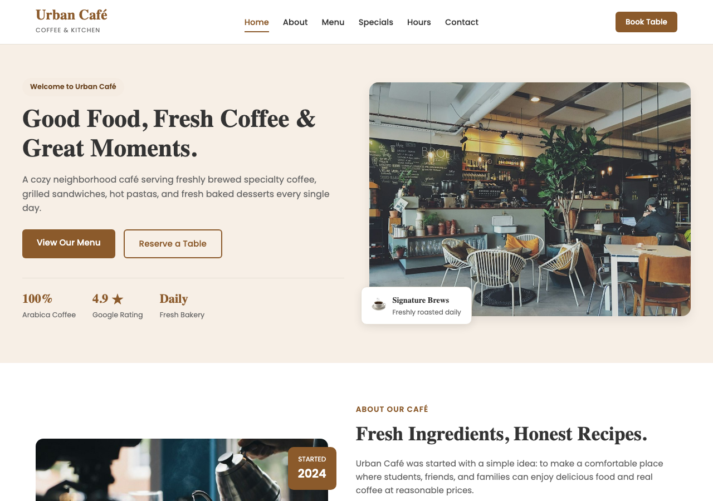
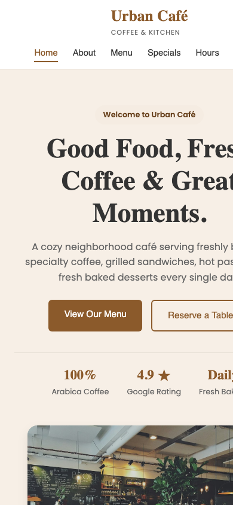

# ☕ Urban Café — Modern Coffeehouse & Kitchen

> **Web Development Continuous Assessment (CA) Project 1**  
> **Student:** Harshit Raj  
> **Degree & Year:** B.Tech CSE (AI-First) — 1st Year  
> **Institution:** ALTA School of Technology / ADYPU  
> **Subject:** Web Development Foundations (HTML, CSS, JS) Lab (Course ID: 29282)  
> **Instructor:** Mohd Umar Siddiqui  

---

## 🌟 Project Overview
**Urban Café** is a responsive, modern restaurant and coffeehouse website crafted using clean, semantic **HTML5** and **CSS3**. It represents a neighborhood artisanal café serving freshly roasted specialty espresso, handcrafted bakery items, and gourmet brunch plates.

The website strictly follows the course guidelines, using standard web technologies taught across Lectures 1 through 7 (Semantic HTML, Box Model, Flexbox, CSS Grid, CSS Positioning, and Responsive Media Queries).

---

## 🚀 Live Demo & Links
- **Live Website (GitHub Pages):** [https://harshitraj0073-star.github.io/urban-cafe/](https://harshitraj0073-star.github.io/urban-cafe/)
- **Live Website (Vercel):** [https://urban-cafe-harshit-raj.vercel.app](https://urban-cafe-harshit-raj.vercel.app)
- **GitHub Repository:** [https://github.com/harshitraj0073-star/urban-cafe](https://github.com/harshitraj0073-star/urban-cafe)
- **Vercel Project Dashboard:** [https://vercel.com/harshit-raj/urban-cafe](https://vercel.com/harshit-raj/urban-cafe)

---

## 📸 Screenshots (Desktop & Mobile)

| Desktop View (1280px) | Mobile Responsive View (390px) |
|:---:|:---:|
|  |  |

---

## 📋 Course Rubric & Implemented Features

| # | Required Feature (From PDF Brief) | Implementation Details |
|:---:|:---|:---|
| **1** | **Header & Navigation Bar** | Semantic `<header>` and `<nav>` with brand logo, smooth navigation links to all page sections, and a "Book Table" button. |
| **2** | **Hero Section** | Welcoming headline, narrative description, dual call-to-action buttons ("Explore Menu" & "Reserve Table"), quick café statistics, and a floating signature brew badge positioned using CSS `position: absolute`. |
| **3** | **About Us Story** | Narrative explaining the café's heritage, sustainable estate sourcing, and 3 distinct highlight cards (Farm Fresh, Handmade Bakery, Cozy Space). |
| **4** | **8 Food & Beverage Menu Items** | CSS Grid featuring 8 distinct items across Starters, Gourmet Mains, Bakery Desserts, and Specialty Coffee with prices, dietary tags (`🌱 Veg`), and badge positioning (`Bestseller`, `Chef's Special`). |
| **5** | **Specials & Promotional Offers** | Featured Weekend Brunch combo banner (with promo code `URBANBRUNCH`) plus secondary promotional cards for Student Discounts and Happy Hours. |
| **6** | **Customer Testimonials** | 3-column patron review cards featuring star ratings (★★★★★), feedback quotes, and customer avatars. |
| **7** | **Opening Hours Table** | Semantic HTML `<table>` (from Lecture 4) with `<thead>`, `<tbody>`, `<th>`, `<td>`, and `colspan` displaying daily operational timings and service badges. |
| **8** | **Reservation & Contact Form** | Semantic HTML `<form>` (from Lecture 3) with fields for Full Name, Phone, Email, Guest count dropdown (`<select>`), Date picker, Time slot, and special requests (`<textarea>`). |
| **9** | **Full Responsiveness** | Customized CSS `@media` queries covering Mobile (<768px), Tablet (768px–1024px), and Desktop (>1024px). |
| **10** | **Clean Footer** | Multi-column footer with brand overview, quick navigation, visit hours, social media handles, and developer attribution. |

---

## 🛠️ Technologies & Concepts Used

- **HTML5:**
  - Semantic elements: `<header>`, `<nav>`, `<main>`, `<section>`, `<article>`, `<table>`, `<thead>`, `<tbody>`, `<tr>`, `<th>`, `<td>`, `<form>`, `<label>`, `<input>`, `<select>`, `<textarea>`, `<footer>`.
  - Proper attributes: `alt` text on all images, `required` fields on forms, and anchor IDs for smooth in-page jumping.
- **CSS3:**
  - **Design Tokens / CSS Variables:** Consistent color palette (warm espresso brown, terracotta, cream off-white, and soft slate).
  - **CSS Box Model:** Strict padding, border, and margin management with `box-sizing: border-box`.
  - **Flexbox Layouts:** Header navigation, hero content, promotional banners, and form rows.
  - **CSS Grid:** 4-column menu card grid, 3-column testimonials.
  - **CSS Positioning:** `position: sticky` navigation bar and `position: absolute` badges over `position: relative` image containers.
  - **CSS Animations:** Subtle `@keyframes floatBadge` animation.
  - **Media Queries:** Dynamic breakpoint adjustments for mobile phones and tablets.

---

## 📂 Project Structure
```text
urban-cafe/
│
├── index.html          # Main semantic HTML5 webpage
├── style.css           # Clean, modular CSS3 stylesheet
├── README.md           # Project documentation and submission details
│
└── images/             # Optimized, high-resolution food & café assets
    ├── hero-cafe.jpg
    ├── about-cafe.jpg
    ├── wedges.jpg
    ├── toast.jpg
    ├── sandwich.jpg
    ├── pasta.jpg
    ├── cheesecake.jpg
    ├── brownie.jpg
    ├── latte.jpg
    ├── lemonade.jpg
    └── special-brunch.jpg
```

---

## 💻 How to Run Locally

1. **Clone the repository:**
   ```bash
   git clone https://github.com/harshitraj0073-star/urban-cafe.git
   ```
2. **Navigate to the project folder:**
   ```bash
   cd urban-cafe
   ```
3. **Open `index.html` in any web browser:**
   - Double click `index.html` or open via Live Server in VS Code.

---

## 🎓 Viva Defence Cheat Sheet

- **Why use Semantic HTML instead of only `<div>` tags?**  
  Semantic tags (`<header>`, `<nav>`, `<section>`, `<article>`, `<footer>`) give structural meaning to the content, improving accessibility for screen readers and search engine optimization (SEO).
- **Why use CSS Grid for the menu and Flexbox for the navbar?**  
  Flexbox is one-dimensional (ideal for arranging items in a single row or column like a navigation bar), while CSS Grid is two-dimensional (ideal for multi-column, multi-row card layouts like a restaurant menu).
- **How are the menu badges positioned?**  
  The card container has `position: relative`, and the badge has `position: absolute; top: 12px; left: 12px;`, keeping the badge anchored to the card corner regardless of screen size.
- **How does the site achieve responsiveness?**  
  Using CSS `@media screen and (max-width: 768px)`, the 4-column menu grid seamlessly switches to 1 column on mobile phones, form inputs stack vertically, and padding scales down for smaller screens.

---

**Developed with ❤️ by Harshit Raj · Urban Café © 2026**
